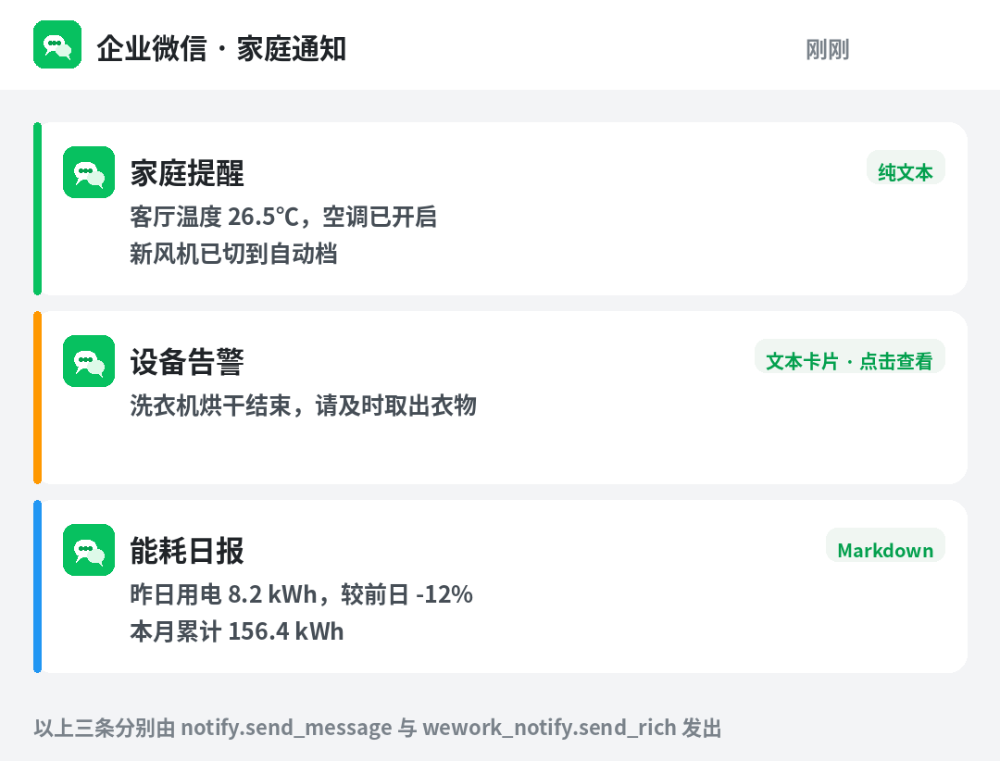

# 企业微信通知（Home Assistant 自定义集成）

[](https://my.home-assistant.io/redirect/hacs_repository/?owner=JochenZhou&repository=ha-wework-notify&category=integration)
[](https://my.home-assistant.io/redirect/config_flow_start/?domain=wework_notify)



把 Home Assistant 的通知推到**企业微信自建应用**：全体成员或指定成员都能收到，手机端与电脑端同步。

- 📄 **纯文本** —— 走标准 `notify.send_message`，任何自动化都能直接调用
- 🗂️ **文本卡片** —— 带标题、正文和跳转按钮，适合告警
- 📰 **图文消息** —— 带封面图，适合日报/汇总
- ✍️ **Markdown** —— 支持加粗、引用，适合数据播报

全部配置都在 **UI 里点选**，不用改 YAML；一个 HA 可以同时配多个企业微信应用。

## 快速开始

### 1. 在企业微信后台准备一个自建应用

1. 打开 [企业微信管理后台](https://work.weixin.qq.com/) → **我的企业 → 企业信息**，记下最下方的 **企业 ID（corpid）**。
2. **应用管理 → 应用 → 创建应用**，填个名字（比如「家庭助理」），创建后进入应用详情页。
3. 在详情页记下 **AgentId** 和 **Secret**（Secret 点「查看」，会发到企业微信里）。
4. ⚠️ **关键一步**：在应用详情页下方找到 **企业可信 IP**，把你 Home Assistant 的**公网出口 IP** 加进去。
   不加这一步，发送时会报 `60020 not allow to access from your ip`。

> 查 HA 的公网出口 IP：在 HA 里打开「终端」执行 `curl -s ifconfig.me`，
> 或者用任意在线 IP 查询网站。家宽 IP 一般是动态的，变了要回来改。

### 2. 装集成

**方式一（推荐）**：点页面顶部第一个徽章 **「一键添加到 HACS」**，浏览器会跳到你的 HA 并打开本仓库，
确认添加后在 HACS 里搜「企业微信通知」下载，然后**重启 Home Assistant**。

**方式二**：HACS → 右上角三个点 → **自定义存储库** → 粘贴
`https://github.com/JochenZhou/ha-wework-notify` → 类型选 **集成** → 添加 → 下载 → 重启。

**方式三（不用 HACS）**：下载本仓库，把 `custom_components/wework_notify` 整个目录
拷到 HA 的 `/config/custom_components/` 下，重启。

### 3. 添加集成

点页面顶部第二个徽章 **「打开 Home Assistant 添加集成」**，或者手动：
**设置 → 设备与服务 → 添加集成 → 搜索「企业微信通知」**，填入：

| 字段 | 说明 |
|---|---|
| 企业 ID（corpid） | 我的企业 → 企业信息 最下方 |
| 应用 AgentId | 自建应用详情页 |
| 应用 Secret | 自建应用详情页，点「查看」 |
| 默认接收人 | 填 `@all` 表示应用可见范围内所有人；也可填 `user1\|user2`（成员账号） |
| 接口地址 | 默认不用改，只有自建网关/本地联调才改 |

提交时集成会真的去企业微信换一次 token，**凭据错了当场就会提示**，不会留下一个坏条目。

配好之后你会得到一个通知实体，比如 `notify.qi_ye_wei_xin_tong_zhi`（用中文名的拼音）。

## 使用

### 发一条纯文本

任何能发通知的地方都能用，比如自动化里选「发送通知」→ 目标选「企业微信通知」：

```yaml
action: notify.send_message
target:
  entity_id: notify.qi_ye_wei_xin_tong_zhi
data:
  title: 家庭提醒
  message: 客厅温度 26.5℃，空调已开启
```

带标题时，消息会渲染成：

```
家庭提醒
——————————
客厅温度 26.5℃，空调已开启
```

（分隔线沿用旧版 `wework_notify` 的观感，老用户不会觉得陌生。）

### 发富消息

`wework_notify.send_rich` 支持 `text` / `textcard` / `news` / `markdown` 四种类型，
全部字段在 UI 里都是下拉框和输入框，不用手写 JSON：

```yaml
action: wework_notify.send_rich
data:
  msgtype: textcard
  title: 设备告警
  message: 洗衣机烘干结束，请及时取出衣物
  url: https://example.com/laundry
```

图文消息（`news`）多 `picurl` 封面图；Markdown（`markdown`）支持 `**加粗**` 和 `> 引用`：

```yaml
action: wework_notify.send_rich
data:
  msgtype: markdown
  title: 能耗日报
  message: |
    **昨日用电** 8.2 kWh
    > 较前日 -12%
```

同一个 HA 配了多个企业微信应用时，用 `entry_id` 只推到其中一个；不填就推全部。

### 常见玩法

```yaml
# 洗衣机洗完提醒
trigger:
  - platform: state
    entity_id: sensor.washing_machine_status
    to: "finished"
action:
  - action: notify.send_message
    target:
      entity_id: notify.qi_ye_wei_xin_tong_zhi
    data:
      title: 洗衣机
      message: 洗衣完成，记得晾衣服

# 每天 8 点能耗日报
trigger:
  - platform: time
    at: "08:00:00"
action:
  - action: wework_notify.send_rich
    data:
      msgtype: markdown
      title: 能耗日报
      message: >
        **昨日用电** {{ states('sensor.daily_energy') }} kWh
```

## FAQ

### 报 `60020 not allow to access from your ip`

HA 的出口 IP 不在应用的**企业可信 IP** 里。去管理后台加上即可（见「快速开始」第 1 步第 4 条）。
家宽 IP 变了也会再报这个，重新加一次。

### 添加集成时报 `invalid_auth`

三种可能，按顺序查：企业 ID 填错（是 `ww` 开头的那个，不是应用 ID）、
Secret 复制时带了空格、AgentId 不是数字。

### 消息发出去但没人收到

`@all` 的范围是**应用可见范围**，不是全公司。检查：
**应用管理 → 应用 → 点进应用 → 可见范围** 里有没有包含目标成员。
也可以在集成选项里把接收人改成具体成员账号（`user1|user2`）。

### 实体名为什么是拼音？

HA 用中文名生成 entity_id 时按拼音转写，`企业微信通知` → `notify.qi_ye_wei_xin_tong_zhi`。
想改名：**设置 → 设备与服务 → 实体** 里搜到它，点齿轮改 `entity_id`。
已存在的实体改名不会弄断自动化（实体 ID 会跟着你改）。

### 从旧版 `wework_notify`（YAML 配置）升级

旧版是在 `configuration.yaml` 里写 `notify: - platform: wework_notify`，
**新版不再支持这种写法**。迁移步骤：

1. 把 `configuration.yaml` 里那段 `- platform: wework_notify` 删掉，重启。
2. 按「快速开始」用 UI 添加集成（填的还是同一套 corpid / agentId / secret / touser）。
3. 通知服务名会变：旧版 `notify.wework` → 新版实体 `notify.<你的条目名>`。
   自动化里的 `action: notify.wework` 要改成 `action: notify.send_message` + `target.entity_id`。

### 支持 media / image / file 类型吗

暂不支持。企业微信这几种类型要先调 `media/upload` 传素材再发，本地文件路径在容器里也更麻烦。
需要的话开 issue 说场景。

## 原理

- 集成启动时用 corpid + secret 调 `gettoken` 换 `access_token`，缓存在内存里，
  提前 5 分钟自动刷新；发送时如果碰到 `42001 token expired` 会自动刷新重试一次。
- 所有 HTTP 走 HA 的共享 aiohttp 会话（异步、有超时），不会阻塞事件循环。
- 通知实体的 `state` 是**上一次成功推送的时间戳**，默认 `unknown`（表示从未成功推过）。
  所以你可以直接用 `state` 判断「今天到底发没发出去」。
- 失败会抛 `HomeAssistantError`，自动化里能捕获；日志里带企业微信返回的原始 errcode。

## 许可

MIT。图标与效果图为本项目自制，不包含腾讯官方素材。

---

> 本项目与腾讯、企业微信官方无关，只是调用公开的群机器人/应用消息 HTTP 接口。
